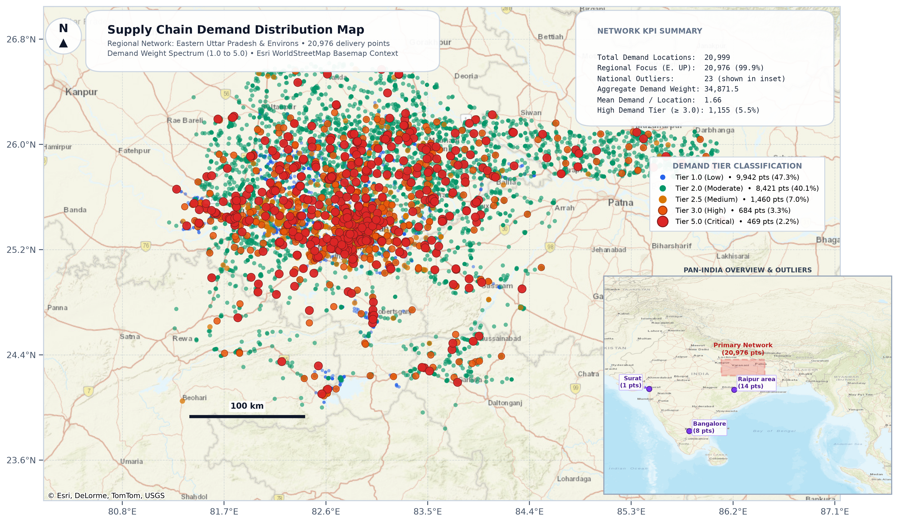

# Supply Chain Network & Geospatial Demand Optimization

An end-to-end geospatial analytics and supply chain optimization project mapping **20,999 customer demand locations** across Eastern Uttar Pradesh and India, integrated with linear programming (LP) network models.

---

## 🗺️ High-Resolution Cartographic Visualization



*High-resolution map generated with Web Mercator projection (EPSG:3857) over unwatermarked Esri WorldStreetMap basemap tiles.*

---

## 🌐 Interactive Web Map (GitHub Pages Ready)

An interactive, zero-dependency Leaflet web map is included in [`index.html`](index.html) (also accessible via [`map_visualization.html`](map_visualization.html)).

### Key Features:
* **Interactive Base Layers**: Toggle between Esri Street Map, OpenStreetMap Standard, Esri Light Gray Canvas, Topographic, and Satellite Imagery.
* **Dynamic Demand Filtering**: Isolate specific customer tiers (1.0, 2.0, 2.5, 3.0, 5.0) with real-time counters.
* **Location ID Lookup**: Jump directly to any location (`ID 1 – 20,999`) with coordinate tooltips.
* **Regional Jump Shortcuts**: Instant zoom presets for Eastern UP, Varanasi, Prayagraj, Jaunpur, Mirzapur, Gorakhpur, and national outliers (Bangalore, Surat, Raipur).

> **To enable public live web viewing on GitHub**:
> 1. Go to repository **Settings** &rarr; **Pages**.
> 2. Under **Build and deployment**, set source to **Deploy from a branch**.
> 3. Select branch `main` and folder `/ (root)`, then click **Save**.
> 4. Your interactive map will be live at `https://<username>.github.io/<repo>/`!

---

## 📊 Network KPI Summary

| Metric | Value | Description |
| :--- | :--- | :--- |
| **Total Customer Locations** | **20,999** | Full delivery footprint |
| **Primary Regional Network** | **20,976 (99.89%)** | Eastern UP (Varanasi, Prayagraj, Jaunpur, Gorakhpur, Sonbhadra) |
| **National Outliers** | **23 (0.11%)** | Distant points: Bangalore (8), Raipur (14), Surat (1) |
| **Aggregate Demand Weight** | **34,871.5 units** | Total network volume |
| **Average Demand / Node** | **1.66 units** | Mean location volume |
| **Critical Priority (Tier 5.0)** | **469 nodes (2.2%)** | High-volume supply distribution hubs |

### Demand Tier Classification

* **Tier 1.0 (Low)**: Blue (`#2563eb`) &bull; 9,942 points (47.3%)
* **Tier 2.0 (Moderate)**: Emerald Green (`#059669`) &bull; 8,421 points (40.1%)
* **Tier 2.5 (Medium)**: Amber Gold (`#d97706`) &bull; 1,460 points (7.0%)
* **Tier 3.0 (High)**: Tangerine Orange (`#ea580c`) &bull; 684 points (3.3%)
* **Tier 5.0 (Critical)**: Vivid Crimson Red (`#dc2626`) &bull; 469 points (2.2%)

---

## 📂 Repository Structure

```
├── AI for DS Sample Data.csv          # Raw geospatial delivery dataset (20,999 records)
├── generate_map.py                    # Standalone reproducible map generation script
├── supply_chain_map.png               # High-resolution (300 DPI) publication image
├── supply_chain_map.pdf               # Vector format map document
├── index.html                         # Interactive Leaflet web map (GitHub Pages entrypoint)
├── map_visualization.html             # Standalone interactive web map application
├── AI Jupyer Notebook Example...ipynb # Supply chain linear programming optimization model
├── AI Hands-On Slides.pdf             # Executive presentation slides
└── README.md                          # Project documentation and summary
```

---

## 🚀 How to Run Locally

### 1. Install Dependencies
```bash
pip install pandas matplotlib contextily xyzservices pillow
```

### 2. Generate Static Maps (PNG & PDF)
```bash
python generate_map.py
```
Outputs `supply_chain_map.png` (300 DPI) and `supply_chain_map.pdf`.

### 3. Launch Interactive Map in Browser
Open `index.html` or `map_visualization.html` directly in any web browser (Google Chrome, Firefox, Edge, Safari).
