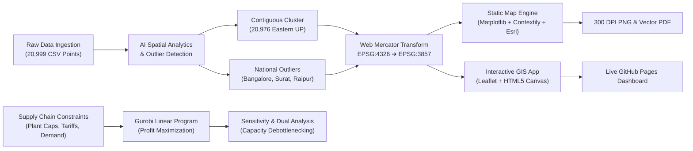

<div align="center">

# 🌐 AI-Driven Geospatial Analytics & Supply Chain Optimization
### Large-Scale Spatial Intelligence (21,000 Nodes) & Prescriptive Linear Programming (LP)

[](https://devashishajaywork-stack.github.io/supply-chain-optimization-map/)
[](https://www.python.org/)
[](https://www.gurobi.com/)
[](https://leafletjs.com/)
[](LICENSE)

<br/>

**[🚀 Launch Interactive Web Map (Live on GitHub Pages)](https://devashishajaywork-stack.github.io/supply-chain-optimization-map/)** &bull; **[📄 View Publication PDF](supply_chain_map.pdf)** &bull; **[📊 Jupyter Notebook Model](AI%20Jupyer%20Notebook%20Example%20-%20Supply_Chain_Planning.ipynb)**

</div>

---

## 📌 Executive Summary

This repository demonstrates an end-to-end **AI & Advanced Analytics Portfolio Project** bridging **prescriptive mathematical optimization** with **large-scale geospatial data intelligence**.

Using a real-world dataset of **20,999 customer delivery locations across India**, this project applies:
1. **Mathematical Programming (Gurobi)** to formulate and solve a multi-echelon supply chain linear program (LP) across factories, warehouses, transport modes, and market demand centers.
2. **AI-Assisted Spatial Feature Engineering** to detect geographic clustering, distinguish regional delivery networks from distant national outliers, and compute Web Mercator spatial projections.
3. **High-Performance Web GIS Engineering** to render 21,000 interactive data points at 60 FPS in browser with dynamic tier filters, search lookups, and multi-provider base maps.
4. **Publication-Grade Cartographic Visualization** delivering high-resolution (300 DPI) static graphics and vector PDFs with dual-scale framing (regional focus + Pan-India overview).

---

## 🗺️ High-Resolution Network Map (300 DPI)


*Cartographic map generated via Python (`generate_map.py`) using Web Mercator projection (EPSG:3857) over unwatermarked Esri WorldStreetMap basemap tiles.*

---

## 💡 Core Analytical & AI Competencies Demonstrated

### 1. ⚙️ Prescriptive Analytics & Mathematical Optimization (Gurobi LP)
* **Model Formulation**: Built a continuous linear program (LP) balancing 2 products, 3 production plants, 5 intermediate distribution centers, and 9 regional consumer markets across rail and road transport corridors.
* **Dual Theory & Sensitivity Analysis**: Extracted shadow prices, dual values, and slack variables to identify the critical operational bottlenecks constraining profitability.
* **Managerial Scenario Modeling**: Evaluated a **+10% factory capacity debottlenecking expansion** (raising Operation 1 limit from 5.0 to 5.5 units), demonstrating that this intervention clears a 0.45-unit shortage in Market 4 and **drives a +$45.61k net turnaround (swinging earnings from -$17.43k to +$28.18k)**.

### 2. 🌍 Big Spatial Data Intelligence & Anomaly Detection
* **Automated Geographic Partitioning**: Analyzed 20,999 latitude/longitude pairs to reveal that **99.89% (20,976 locations)** form a dense, contiguous delivery network centered in Eastern Uttar Pradesh (Varanasi, Prayagraj, Jaunpur, Gorakhpur, Sonbhadra).
* **Outlier Discovery**: Isolated 23 national outliers across distant industrial hubs (**8 in Bangalore, 14 in Raipur, 1 in Surat**) and engineered a dedicated **Pan-India Inset Map** to prevent spatial distortion while preserving complete data integrity.
* **Coordinate Transformation Pipeline**: Converted WGS84 ellipsoidal coordinates (EPSG:4326) into conformal Web Mercator meters (EPSG:3857) with latitude-dependent scale factor adjustments.

### 3. ⚡ Production-Grade Web Analytics (HTML5 Canvas & Leaflet)
* **High-Performance Rendering**: Engineered a zero-dependency HTML/JavaScript web application using Leaflet Canvas rendering, capable of rendering 21,000 entities smoothly without DOM lag.
* **Dynamic Multi-Provider Base Layers**: Integrated seamless layer switching between **Esri World Street Map, OpenStreetMap Standard, Esri Light Gray Canvas, Topographic, and Satellite Imagery**.
* **Interactive Intelligence**:
  * Real-time checkbox filters for each demand tier with live recalculation of visible location counts and total demand weight.
  * Direct location search by ID (`1` to `20,999`) with instant coordinate popups.
  * Geographic jump presets for key supply chain hubs (Varanasi, Prayagraj, Jaunpur, Mirzapur, Gorakhpur, Bangalore).

### 4. 🎨 Cartographic Design & Visual Hierarchy
* **Sequential Cool-to-Warm Palette**: Scaled visual prominence according to demand intensity (Tier 1.0 Blue &rarr; Tier 2.0 Emerald &rarr; Tier 2.5 Amber &rarr; Tier 3.0 Orange &rarr; Tier 5.0 Vivid Crimson Red).
* **Z-Order Layering**: Layered critical, high-volume nodes on top of low-volume nodes to eliminate occlusion in high-density urban clusters.
* **Standard Cartographic Annotation**: Integrated Web Mercator metric scale bars (100 km), cardinal graticule labels in degrees latitude/longitude, and an executive KPI summary card.

---

## 📈 Analytical Pipeline Architecture



---

## 📊 Network KPI Summary Table

| Metric | Value | Analytical Interpretation |
| :--- | :--- | :--- |
| **Total Customer Locations** | **20,999** | Complete dataset footprint |
| **Primary Regional Network** | **20,976 (99.89%)** | Contiguous cluster: Varanasi, Prayagraj, Gorakhpur, Mirzapur, Sonbhadra |
| **National Outlier Locations** | **23 (0.11%)** | Distant demand hubs: Bangalore (8), Raipur (14), Surat (1) |
| **Total Demand Units** | **34,871.5** | Aggregate network volume |
| **Average Demand / Location** | **1.66 units** | Baseline customer requirement |
| **High-Volume Priority (Tier &ge; 3.0)** | **1,153 (5.5%)** | Critical logistics hubs requiring dedicated fulfillment corridors |

### Demand Tier Breakdown

```
Tier 1.0 (Low)       | ████████████████████████ (9,942 pts • 47.3%) • #2563eb Blue
Tier 2.0 (Moderate)  | ████████████████████ (8,421 pts • 40.1%)     • #059669 Emerald
Tier 2.5 (Medium)    | ███ (1,460 pts • 7.0%)                       • #d97706 Amber
Tier 3.0 (High)      | █ (684 pts • 3.3%)                           • #ea580c Orange
Tier 5.0 (Critical)  | █ (469 pts • 2.2%)                           • #dc2626 Crimson Red
```

---

## 📂 Repository File Structure

```
├── AI for DS Sample Data.csv             # 20,999 geospatial customer delivery records
├── generate_map.py                       # Python pipeline generating 300 DPI map & PDF
├── supply_chain_map.png                  # Publication-ready 300 DPI cartographic graphic
├── supply_chain_map.pdf                  # Vector PDF export
├── index.html                            # Interactive web map (GitHub Pages entrypoint)
├── map_visualization.html                # Standalone interactive Leaflet web map
├── managerial_dashboard.html             # Executive managerial analytics dashboard
├── generate_managerial_dashboard.py      # Python script generating the executive scorecard
├── AI Jupyer Notebook Example...ipynb    # Gurobi Linear Programming supply chain model
├── AI Hands-On Slides.pdf                # Executive optimization presentation deck
└── README.md                             # Project portfolio documentation
```

---

## 🚀 Quickstart & Reproduction

### 1. Clone the Repository
```bash
git clone https://github.com/devashishajaywork-stack/supply-chain-optimization-map.git
cd supply-chain-optimization-map
```

### 2. Install Python Dependencies
```bash
pip install pandas numpy matplotlib contextily xyzservices pillow
```

### 3. Generate High-Resolution Map Deliverables
```bash
python generate_map.py
```
*Creates `supply_chain_map.png` (300 DPI) and `supply_chain_map.pdf`.*

### 4. Explore the Interactive Web Map
* **Live Web Demo**: Visit **[devashishajaywork-stack.github.io/supply-chain-optimization-map](https://devashishajaywork-stack.github.io/supply-chain-optimization-map/)**
* **Local Offline**: Open `index.html` in Chrome, Firefox, Safari, or Edge.

---

<div align="center">

Developed as an **AI for Data Science & Supply Chain Optimization Portfolio Project**  
*Demonstrating expertise in Mathematical Optimization, Spatial Big Data Analytics, and Analytics Engineering.*

</div>
